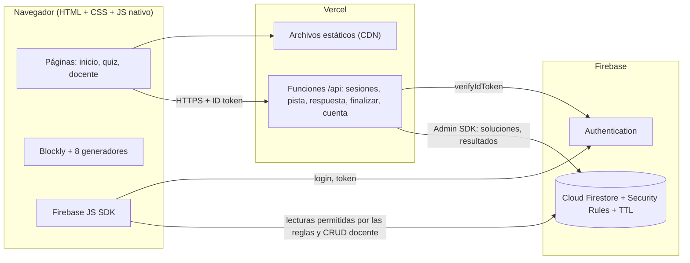

# BlockBridge Academy v2 — Visión, alcance y stack tecnológico

| | |
|---|---|
| **Versión** | 2.0 (rediseño) |
| **Fecha** | 29 de octubre de 2026 |
| **Autor** | [Nombre del desarrollador] |
| **Contexto** | Proyecto académico — MIIDT, Temas Selectos |
| **Estado** | Borrador para revisión |

## Índice de documentos

| # | Documento | Contenido |
|---|---|---|
| 00 | Este documento | Visión, decisiones, alcance, stack, arquitectura, riesgos y fases |
| 01 | [01-SRS.md](01-SRS.md) | Especificación de requisitos (ISO/IEC/IEEE 29148, compatible con IEEE 830) |
| 02 | [02-casos-de-uso.md](02-casos-de-uso.md) | Diagrama y especificación detallada de casos de uso |
| 03 | [03-historias-de-usuario.md](03-historias-de-usuario.md) | Historias de usuario con criterios de aceptación |
| 04 | [04-diagramas.md](04-diagramas.md) | Diagramas de clases, entidad-relación, secuencia y estados |
| 05 | [05-privacidad-y-datos.md](05-privacidad-y-datos.md) | Aviso de privacidad y política de manejo de datos |

---

## 1. Problema y visión

Un estudiante que empieza a programar suele tropezar antes con la **sintaxis** del lenguaje que con la **lógica** del programa. Un punto y coma que falta o una llave mal cerrada le cuestan horas, y el razonamiento algorítmico, que es lo que de verdad se quiere enseñar, queda en segundo plano.

**Visión:** una aplicación web en la que el estudiante arma programas con **bloques visuales**, ve al momento el código equivalente en el lenguaje que elija (Java, Kotlin, C#, C++, C, Python, JavaScript o PHP) y resuelve **quizzes calificados de 0 a 100**. Recibe retroalimentación inmediata y puede usar pistas, que restan puntaje. El docente crea ejercicios y consulta el desempeño en un panel que exporta a CSV y PDF.

## 2. Decisiones tomadas (trazables a la entrevista de requisitos)

| # | Tema | Decisión |
|---|---|---|
| 1 | Contexto | Proyecto académico con alumnos ficticios, diseñado para poder escalar a un uso real |
| 2 | Equipo | 1 desarrollador. Se prioriza JavaScript nativo por simplicidad y rendimiento, sin framework |
| 3 | Restricciones | Solo las que impone tener un único desarrollador |
| 4 | Roles | Estudiante y Docente en el MVP. Administrador (que actúa también como DBA) fuera del MVP como interfaz |
| 5 | Acceso | Se permite el uso anónimo, con autenticación y roles garantizados y sin puertas traseras |
| 6 | Grupos | Con código de acceso, **fuera del MVP** |
| 7 | Concurrencia | Menos de 50 usuarios simultáneos |
| 8 | Lenguajes | Java, Kotlin, C#, C++, C, Python, JavaScript y PHP |
| 9 | Temas | De variables hasta POO; POO se considera **avanzado** y aplica solo donde el lenguaje la soporta |
| 10 | Tipo de ejercicio | Armar con bloques el programa que resuelve el enunciado |
| 11 | Origen del contenido | Banco precargado y ejercicios creados por el docente |
| 12 | Validación | **Comparación estructural de bloques**: no se ejecuta código |
| 13 | Escala | 0 a 100 |
| 14 | Intentos | Ilimitados y sin penalización |
| 15 | Dificultad | Tres niveles; todos los ejercicios valen lo mismo |
| 16 | Pistas y tiempo | Las pistas restan puntaje; hay un cronómetro visible |
| 17 | Retroalimentación | Inmediata y con explicación |
| 18 | Gamificación | Fuera del MVP |
| 19 | Panel docente | Dashboard básico con descarga en CSV y PDF |
| 20 | Dispositivos | Diseño responsive para cualquier dispositivo |
| 21 | LMS | Sin integración |
| 22 | Sin conexión | No se requiere |
| 23 | Hosting | Vercel (plan gratuito) |
| 24 | BD y autenticación | Firebase (Authentication y Cloud Firestore) |
| 25–26 | Entregables | Casos de uso, especificaciones, SRS, historias de usuario, diagramas y privacidad, en Markdown y PDF |

## 3. Actores

| ID | Actor | Tipo | Descripción |
|---|---|---|---|
| ACT-01 | **Visitante** | Primario | Persona que usa el sistema sin registrarse (sesión anónima de Firebase). Puede resolver quizzes; su progreso es temporal y nadie lo identifica |
| ACT-02 | **Estudiante** | Primario | Usuario registrado con apodo, correo y contraseña. Hereda todo lo que puede hacer el Visitante y además conserva su historial y aparece en el panel del docente |
| ACT-03 | **Docente** | Primario | Usuario registrado al que el Administrador asignó el rol `docente`. Crea ejercicios y quizzes, consulta resultados y los exporta |
| ACT-04 | **Administrador / DBA** | Primario (fuera del MVP como interfaz) | Opera desde la **Consola de Firebase**: asigna el rol docente, carga el banco precargado y atiende las solicitudes de derechos ARCO. En el MVP no tiene pantallas propias |
| ACT-05 | **Firebase Authentication** | Secundario | Proveedor de identidad: sesiones anónimas, correo y contraseña, verificación y recuperación |
| ACT-06 | **Servicio de evaluación** | Secundario | Vercel Functions: califican, entregan pistas y registran tiempos. Es la única parte del sistema que puede escribir resultados |

## 4. Alcance

### 4.1 Dentro del MVP

- **Cuentas:** uso anónimo; registro e inicio de sesión con correo y contraseña; recuperación de contraseña; conversión de una cuenta anónima en registrada sin perder el progreso; eliminación de la cuenta y de sus datos.
- **Roles:** `estudiante` por defecto. `docente` lo asigna únicamente el DBA desde la consola (procedimiento documentado, sin endpoint).
- **Editor de bloques:** un conjunto común de bloques independiente del lenguaje, con vista del código generado en los 8 lenguajes y cambio de lenguaje en vivo.
- **Temas:** 1) variables y tipos, 2) operadores y expresiones, 3) salida de datos, 4) condicionales, 5) ciclos, 6) funciones, 7) arreglos y listas, 8) cadenas, 9) POO (avanzado: clases, objetos, atributos, métodos, constructor y herencia; no se ofrece en C).
- **Quizzes:** catálogo, selección de lenguaje, cronómetro, hasta 3 pistas con penalización, intentos ilimitados, validación estructural en el servidor, retroalimentación inmediata, puntaje de 0 a 100 y resumen final.
- **Docente:** CRUD de ejercicios (la solución se arma con bloques), CRUD de quizzes, vista previa, duplicado de ejercicios precargados, dashboard y exportación a CSV y PDF.
- **Contenido:** banco precargado con al menos 27 ejercicios (3 por tema, uno por dificultad).
- **Privacidad:** aviso simplificado al registrarse, aviso integral siempre accesible, registro de la versión aceptada y expiración automática de los datos anónimos.
- **Responsive:** de 360 px a escritorio, con arrastre táctil.

### 4.2 Fuera del MVP (fases siguientes)

| Funcionalidad | Cuándo añadirla |
|---|---|
| Grupos con código de acceso | Cuando haya más de un docente con alumnos reales |
| Panel de administración propio | Cuando gestionar roles desde la consola deje de ser práctico |
| Gamificación (insignias, rachas, ranking) | Tras validar el MVP con usuarios |
| Firebase App Check (reCAPTCHA) | Antes de abrir el sistema al público |
| Purga automática de cuentas inactivas (Vercel Cron) | Antes del uso real |
| Descarga de PDF en un clic (sin diálogo de impresión) | Si el diálogo "Guardar como PDF" del navegador no basta |
| Navegación de bloques con teclado (plugin de Blockly) | Para cumplir WCAG completo en el editor |

### 4.3 Excluido

Ejecución de código del estudiante, integración con LMS, funcionamiento sin conexión, otros tipos de ejercicio (Parsons, opción múltiple, encontrar el error) y entrada de datos por teclado (`leer`) en los programas.

## 5. Supuestos y restricciones

| ID | Supuesto o restricción |
|---|---|
| S-01 | **El tiempo se registra y se muestra, pero no afecta el puntaje.** La entrevista pidió un cronómetro, no una penalización por tiempo. Si se quiere un límite de tiempo, se añade como parámetro del quiz |
| S-02 | La comparación estructural acepta **varias soluciones** por ejercicio, registradas por el docente. Si un estudiante llega a una solución válida que no está registrada, se marcará como incorrecta. Es la limitación conocida de no ejecutar código y se mitiga con el renombrado de variables (Anexo B del SRS) |
| S-03 | Penalización por pista por defecto: **20 puntos**, configurable por quiz entre 0 y 50 |
| S-04 | El dashboard muestra el **mejor** puntaje de cada estudiante por quiz |
| S-05 | El código generado es **solo de lectura y didáctico**: se busca que sea idiomático y compile, pero no se ejecuta |
| S-06 | Plan Hobby de Vercel = uso **no comercial**. Para un uso real con la institución hay que migrar a Vercel Pro o a Firebase Hosting con Cloud Functions (plan Blaze) |
| S-07 | Plan Spark de Firebase: 50 000 lecturas, 20 000 escrituras y 20 000 borrados de Firestore al día. Con 50 usuarios × 20 ejercicios × ~6 escrituras ≈ 6 000 escrituras diarias, queda margen suficiente |
| S-08 | Los usuarios menores de edad usan el modo anónimo o se registran con autorización de su madre, padre o tutor (ver doc. 05) |

## 6. Stack tecnológico

| Capa | Tecnología | Por qué | Alternativa descartada |
|---|---|---|---|
| Interfaz | **HTML + CSS + JavaScript nativo (ES modules)**, sin paso de compilación | Lo pidió el desarrollador; carga rápida, nada que configurar y depuración directa en el navegador | React: añade compilación y estado que esta aplicación no necesita |
| Editor de bloques | **Blockly** (Google), versión fijada a número exacto | Estándar de facto (Scratch, Code.org). Trae serialización JSON, temas, soporte táctil y la infraestructura `CodeGenerator` | Escribir un editor propio: meses de trabajo |
| Generadores de código | **8 generadores propios** sobre `Blockly.CodeGenerator`, uno por lenguaje | Los generadores oficiales de Blockly cubren JS, Python y PHP solo para *sus* bloques. Nuestros bloques (tipos, clases) son propios, así que los 8 se escriben con un mismo patrón | Generadores oficiales: no tienen Java, Kotlin, C#, C ni C++ |
| Ruteo | Páginas HTML separadas (`index`, `quiz`, `docente`) | Sin enrutador que mantener | Un router SPA |
| Estilos | CSS nativo (variables, grid, `@media`, `@media print`) | Responsive e impresión a PDF sin librerías | Tailwind: requiere compilación |
| Autenticación | **Firebase Authentication** (anónima + correo/contraseña) | Vincula una cuenta anónima a una registrada (`linkWithCredential`), verifica correos, recupera contraseñas y protege contra la enumeración de correos | Autenticación propia: es la parte más fácil de hacer mal |
| Base de datos | **Cloud Firestore** + Security Rules | Sin servidor que administrar; las reglas imponen los permisos en la base; TTL nativo para borrar datos anónimos | PostgreSQL de la v1: requiere servidor propio |
| Lógica confiable | **Vercel Functions (Node.js)** + `firebase-admin` | Califican en el servidor para que el estudiante no pueda leer las soluciones ni escribirse un 100. Están en el plan gratuito, a diferencia de Cloud Functions, que exige Blaze | Calificar en el cliente: inseguro |
| Hosting | **Vercel** (estáticos + funciones) | Preferencia del desarrollador; HTTPS y CDN incluidos | Firebase Hosting |
| Exportación | CSV con `Blob` nativo; PDF con `window.print()` y hoja `@media print` | Cero dependencias | jsPDF (se añade si hace falta descarga directa) |
| Pruebas | `node:test` (biblioteca estándar de Node) | Pruebas de canonicalización, puntaje y generadores sin instalar frameworks | Jest/Vitest |

**Dependencias totales:** Blockly y Firebase JS SDK en el cliente (cargados como módulos ES desde CDN, con versión exacta); `firebase-admin` en las funciones.

## 7. Arquitectura

**Principio central:** el navegador nunca ve soluciones, pistas no reveladas ni explicaciones de ejercicios sin resolver, y **no puede escribir resultados**. Todo lo que afecta la calificación pasa por las funciones de Vercel, que verifican el token de Firebase en cada petición.

## 8. Relación con la v1

La versión anterior (Next.js 14 + FastAPI + PostgreSQL + Redis + sandbox Piston) **ejecutaba** el código del alumno. Se eliminó de la carpeta al iniciar la iteración 1; su código fuente queda en `v1-respaldo.tar.gz` (excluido del repositorio).

| De la v1 | En la v2 |
|---|---|
| Verificación de generadores sin navegador (`scripts/check-codegen.cjs`) | Misma idea con `node:test` (iteración 2) |
| Paleta con contraste medido y tema de Blockly (`theme.ts`) | Paleta ya portada a `css/app.css`; el tema de bloques se porta en la iteración 2. Ojo: la familia tipográfica del tema debe ser concreta, nunca `inherit`, porque Blockly mide el texto en un `<canvas>` |
| Minimización de datos (apodo en lugar de nombre real; sin código ni IP) | Se mantiene como principio (doc. 05) |
| Sandbox Piston, Redis, FastAPI, PostgreSQL, Docker | **Eliminados**: con validación estructural no hay código que ejecutar |
| `PRIVACY_POLICY.md` | Eliminado; lo sustituyen el doc. 05 y `privacidad.html` |
| `TERMS.md` | Eliminado; lo sustituye `terminos.html`, escrito para la v2 |

## 9. Riesgos

| Riesgo | Prob. | Impacto | Mitigación |
|---|---|---|---|
| Escribir 8 generadores es la mayor carga de trabajo | Alta | Alto | Conjunto de bloques acotado (~35); un mismo patrón por generador; pruebas de igualdad de salida por lenguaje; orden de entrega: Python, JS, Java, C, C++, C#, Kotlin, PHP |
| La validación estructural rechaza soluciones correctas no previstas | Media | Medio | Varias soluciones por ejercicio; renombrado de variables; toolbox restringida por ejercicio para reducir caminos alternativos |
| Superar las cuotas del plan Spark | Baja | Medio | Uso estimado al 30 % de la cuota; alerta de presupuesto; datos anónimos con TTL |
| Arranque en frío de las funciones (`firebase-admin`) | Media | Bajo | Inicializar fuera del *handler*; respuesta p95 < 1,5 s aceptable |
| Un solo desarrollador | Alta | Alto | Alcance MVP cerrado, sin framework, sin servidor propio |
| Escalada de privilegios (que alguien se haga docente) | Baja | Alto | El rol solo se cambia en la consola; las reglas impiden escribir `rol`; pruebas de reglas con el emulador |

## 10. Plan de iteraciones (1 desarrollador, iteraciones de 2 semanas)

| Iteración | Entregable |
|---|---|
| 0 | Documentación de Ingeniería de Software (este paquete) |
| 1 | Proyecto Firebase + Vercel, autenticación (anónima, registro, login, vinculación), reglas de Firestore con pruebas en el emulador |
| 2 | Conjunto de bloques, generadores de Python y JavaScript, editor responsive |
| 3 | Funciones `/api` (sesiones, respuesta, pista, finalizar), canonicalización, puntaje y retroalimentación con pruebas `node:test` |
| 4 | Generadores de Java, C, C++, C#, Kotlin y PHP; banco precargado (27 ejercicios) |
| 5 | Panel docente: CRUD de ejercicios y quizzes, dashboard, CSV y PDF |
| 6 | Privacidad (eliminar cuenta, descargar datos, TTL, limpieza diaria), historial, términos de uso, auditoría de accesibilidad y preparación del despliegue |
