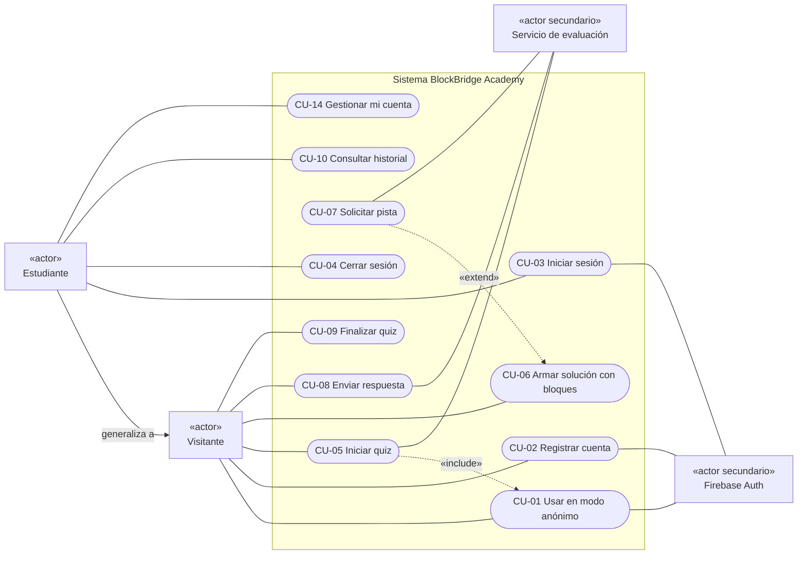
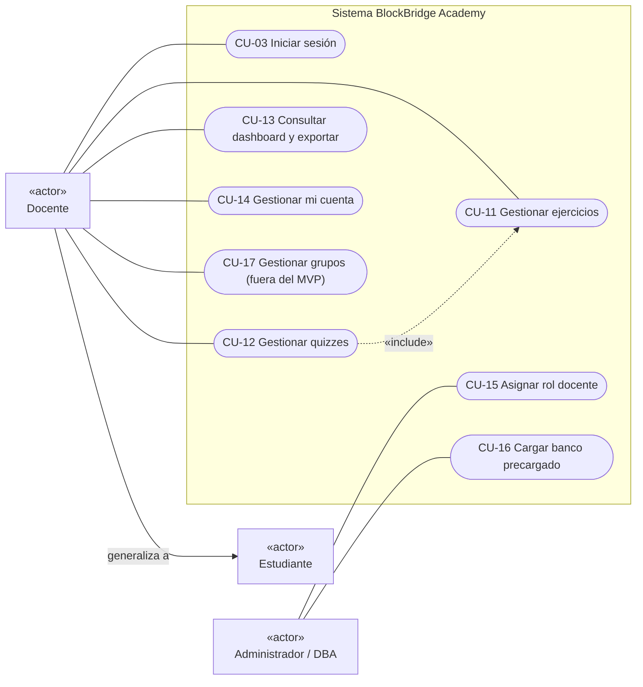

# Casos de uso — BlockBridge Academy v2

| | |
|---|---|
| **Versión** | 2.0 |
| **Fecha** | 29 de octubre de 2026 |
| **Referencias** | Actores: doc. 00 §3 · Reglas de negocio RN-xx y requisitos RF-xx: doc. 01 |

## 1. Catálogo

| ID | Caso de uso | Actor principal | MVP |
|---|---|---|---|
| CU-01 | Usar el sistema en modo anónimo | Visitante | Sí |
| CU-02 | Registrar cuenta | Visitante | Sí |
| CU-03 | Iniciar sesión | Estudiante, Docente | Sí |
| CU-04 | Cerrar sesión | Estudiante, Docente | Sí |
| CU-05 | Iniciar quiz | Visitante, Estudiante | Sí |
| CU-06 | Armar solución con bloques | Visitante, Estudiante | Sí |
| CU-07 | Solicitar pista | Visitante, Estudiante | Sí |
| CU-08 | Enviar respuesta y recibir retroalimentación | Visitante, Estudiante | Sí |
| CU-09 | Finalizar quiz y ver resumen | Visitante, Estudiante | Sí |
| CU-10 | Consultar historial | Estudiante | Sí |
| CU-11 | Gestionar ejercicios | Docente | Sí |
| CU-12 | Gestionar quizzes | Docente | Sí |
| CU-13 | Consultar dashboard y exportar | Docente | Sí |
| CU-14 | Gestionar mi cuenta (cambiar apodo, eliminar cuenta) | Estudiante, Docente | Sí |
| CU-15 | Asignar rol docente | Administrador/DBA | Sí, como procedimiento en la consola |
| CU-16 | Cargar banco precargado | Administrador/DBA | Sí, como script |
| CU-17 | Gestionar grupos con código de acceso | Docente | No |
| CU-18 | Obtener insignias y ver ranking | Estudiante | No |

## 2. Diagramas de casos de uso

### 2.1 Estudiante y visitante

> El Estudiante hereda todos los casos del Visitante. CU-05 incluye CU-01: si nadie ha iniciado sesión, el sistema crea una sesión anónima en silencio.

### 2.2 Docente y administrador

> El Docente también es Estudiante: puede resolver quizzes. CU-12 incluye CU-11 porque un quiz se arma eligiendo ejercicios.

---

## 3. Especificaciones detalladas

### CU-01 Usar el sistema en modo anónimo

| Campo | Contenido |
|---|---|
| **Actor** | Visitante · Secundario: Firebase Auth |
| **Descripción** | Permite resolver quizzes sin registrarse ni dar datos personales |
| **Precondiciones** | No hay sesión activa en el navegador |
| **Disparador** | El visitante pulsa «Probar sin cuenta» o inicia un quiz sin haber iniciado sesión |
| **Postcondiciones** | Hay una sesión anónima con un `uid`. Las sesiones de quiz que cree llevan `anonimo = true` y `expiraEn = ahora + 30 días` |
| **RF / RN** | RF-01, RF-39 · RN-12 |

**Flujo principal**
1. El visitante pulsa «Probar sin cuenta».
2. El sistema llama a `signInAnonymously` en Firebase Auth.
3. Firebase devuelve un usuario anónimo.
4. El sistema muestra el catálogo con el aviso: «Estás en modo invitado: tu progreso se borra en 30 días. Crea una cuenta para conservarlo».

**Flujos alternos**
- **FA-1 La sesión anónima ya existe:** en el paso 2, si el navegador ya tiene un usuario anónimo, se reutiliza.

**Excepciones**
- **E-1 Sin conexión con Firebase:** se muestra «No pudimos conectarnos. Revisa tu conexión e inténtalo de nuevo» con un botón para reintentar.

---

### CU-02 Registrar cuenta

| Campo | Contenido |
|---|---|
| **Actor** | Visitante · Secundario: Firebase Auth |
| **Descripción** | Crea una cuenta de estudiante con apodo, correo y contraseña |
| **Precondiciones** | El usuario no tiene sesión o tiene una sesión anónima |
| **Disparador** | Pulsa «Crear cuenta» |
| **Postcondiciones** | Existe un usuario en Auth y un documento `usuarios/{uid}` con `rol = "estudiante"` y los datos de aceptación del aviso. Se envía un correo de verificación |
| **RF / RN** | RF-02, RF-03, RF-07, RF-37, RF-38 · RN-14 |

**Flujo principal**
1. El sistema muestra el formulario (apodo, correo, contraseña), el **aviso de privacidad simplificado** y dos casillas: «Acepto el aviso de privacidad» y «Soy mayor de edad o tengo autorización de mi madre, padre o tutor».
2. El visitante llena los datos, marca las casillas y envía.
3. El sistema valida en el cliente: apodo de 3 a 30 caracteres, correo con formato válido, contraseña de al menos 8 caracteres con mayúscula, minúscula, número y símbolo, casillas marcadas.
4. El sistema crea la credencial en Firebase Auth.
5. El sistema crea `usuarios/{uid}` con `apodo`, `rol = "estudiante"`, `avisoVersion`, `avisoAceptadoEn` y `creadoEn`. Las reglas rechazan cualquier otro valor de `rol`.
6. El sistema envía el correo de verificación y muestra el catálogo con la sesión iniciada.

**Flujos alternos**
- **FA-1 Viene de una sesión anónima:** en el paso 4 se usa `linkWithCredential` en lugar de crear un usuario nuevo, así el `uid` se conserva. Luego el sistema llama a `/api/sesiones` (acción `reclamar`) para quitar `anonimo` y `expiraEn` de las sesiones de ese `uid`.
- **FA-2 Recomendación de apodo:** si el apodo parece un nombre completo (dos o más palabras con mayúscula inicial), el sistema sugiere no usar el nombre real, sin bloquear el registro.

**Excepciones**
- **E-1 Correo ya registrado:** «No se pudo crear la cuenta con esos datos. Si ya tienes una, inicia sesión». El mensaje es genérico para no revelar qué correos existen.
- **E-2 Contraseña débil:** se indica la regla que no se cumple.
- **E-3 Casillas sin marcar:** no se habilita el botón de envío.

---

### CU-03 Iniciar sesión

| Campo | Contenido |
|---|---|
| **Actor** | Estudiante, Docente · Secundario: Firebase Auth |
| **Precondiciones** | La cuenta existe |
| **Disparador** | Pulsa «Iniciar sesión» |
| **Postcondiciones** | Sesión activa. Si `rol = "docente"` y el correo está verificado, se muestra el menú Docente |
| **RF** | RF-04, RF-05, RF-08 |

**Flujo principal**
1. El usuario ingresa correo y contraseña.
2. El sistema llama a `signInWithEmailAndPassword`.
3. El sistema lee `usuarios/{uid}` para conocer el rol.
4. El sistema muestra el catálogo y, si el rol es docente y el correo está verificado, también el menú Docente.

**Flujos alternos**
- **FA-1 Olvidé mi contraseña:** el usuario pulsa «¿Olvidaste tu contraseña?», escribe su correo y el sistema llama a `sendPasswordResetEmail`. Siempre muestra «Si el correo está registrado, te enviamos un enlace».
- **FA-2 Docente sin correo verificado:** el menú Docente no aparece; en su lugar se muestra «Verifica tu correo para acceder a las funciones de docente» con la opción de reenviar el correo.
- **FA-3 Había una sesión anónima con progreso:** el sistema avisa que ese progreso no se fusionará con la cuenta existente y pide confirmación.

**Excepciones**
- **E-1 Credenciales inválidas:** «Correo o contraseña incorrectos».
- **E-2 Demasiados intentos:** Firebase bloquea temporalmente; se muestra «Demasiados intentos. Espera unos minutos».

---

### CU-04 Cerrar sesión

| Campo | Contenido |
|---|---|
| **Actor** | Estudiante, Docente |
| **Flujo** | 1. El usuario pulsa «Cerrar sesión». 2. El sistema llama a `signOut` y borra del navegador el workspace guardado. 3. Muestra la página de inicio |
| **Postcondiciones** | No queda ninguna sesión activa en el navegador |
| **RF** | RF-06 |

---

### CU-05 Iniciar quiz

| Campo | Contenido |
|---|---|
| **Actor** | Visitante, Estudiante · Secundario: Servicio de evaluación |
| **Descripción** | El usuario elige un quiz y un lenguaje; el servidor abre una sesión de quiz |
| **Precondiciones** | Hay al menos un quiz publicado |
| **Postcondiciones** | Existe `sesiones/{id}` con `estado = "en_curso"`, `inicio` (hora del servidor), `lenguaje` y una entrada por ejercicio en estado `pendiente` |
| **RF / RN** | RF-11, RF-12, RF-13 · RN-10, RN-12 |

**Flujo principal**
1. El sistema muestra el catálogo de quizzes publicados con su tema, dificultad, número de ejercicios y lenguajes.
2. El usuario filtra (opcional) y elige un quiz.
3. El sistema muestra los lenguajes que admite el quiz; el usuario elige uno.
4. Si no hay sesión, se ejecuta **CU-01**.
5. El sistema envía `POST /api/sesiones {quizId, lenguaje}` con el ID token.
6. El servidor verifica el token, que el quiz esté publicado y que admita ese lenguaje. Crea la sesión y devuelve `sesionId` y los ejercicios **sin** soluciones, pistas ni explicaciones, solo con el número de pistas disponibles.
7. El sistema abre el primer ejercicio (**CU-06**) y arranca los cronómetros.

**Flujos alternos**
- **FA-1 Hay una sesión en curso del mismo quiz:** el sistema ofrece «Continuar» (recupera la sesión y su estado) o «Empezar de nuevo» (crea otra sesión).

**Excepciones**
- **E-1 Quiz no publicado o lenguaje no permitido:** el servidor responde 400 y se muestra «Este quiz ya no está disponible».
- **E-2 Token inválido o vencido:** el cliente renueva el token una vez y reintenta; si vuelve a fallar, pide iniciar sesión.

---

### CU-06 Armar solución con bloques

| Campo | Contenido |
|---|---|
| **Actor** | Visitante, Estudiante |
| **Descripción** | El usuario arma su programa arrastrando bloques y ve el código generado |
| **Precondiciones** | Sesión de quiz en curso; ejercicio no resuelto |
| **Postcondiciones** | El workspace está listo para enviarse y guardado en el navegador |
| **Puntos de extensión** | «Pedir pista» → CU-07 |
| **RF** | RF-14, RF-15, RF-16, RF-22, RF-26 |

**Flujo principal**
1. El sistema muestra el enunciado, el editor con la toolbox del ejercicio (y el workspace inicial si lo hay), el panel de código y los cronómetros.
2. El usuario arrastra, conecta y edita bloques.
3. Con cada cambio, el sistema regenera el código en el lenguaje elegido (< 100 ms) y guarda el workspace en el navegador.
4. El usuario puede cambiar de lenguaje en el selector; solo cambia el código mostrado.
5. El usuario pulsa «Comprobar» → **CU-08**.

**Flujos alternos**
- **FA-1 Pantalla menor de 768 px:** enunciado, bloques y código aparecen en pestañas.
- **FA-2 Bloques sueltos:** antes de enviar, el sistema avisa que los bloques que no estén conectados a `programa` ni sean definiciones no se tomarán en cuenta.
- **FA-3 Cambiar de ejercicio u omitir:** el usuario navega con «Anterior» y «Siguiente» u «Omitir». El ejercicio queda `pendiente` y su workspace se conserva en el navegador.
- **FA-4 Reiniciar:** «Reiniciar» restaura el workspace inicial, previa confirmación.

---

### CU-07 Solicitar pista

| Campo | Contenido |
|---|---|
| **Actor** | Visitante, Estudiante · Secundario: Servicio de evaluación |
| **Precondiciones** | Ejercicio no resuelto y con pistas que aún no se han revelado |
| **Postcondiciones** | El contador `pistas` del ejercicio en la sesión aumenta en 1 |
| **RF / RN** | RF-17 · RN-01, RN-04, RN-05 |

**Flujo principal**
1. El usuario pulsa «Pista (n disponibles)».
2. El sistema muestra «Esta pista resta *p* puntos. Puntaje máximo de este ejercicio: de *X* a *Y*. ¿Continuar?».
3. El usuario confirma.
4. El sistema envía `POST /api/pista {sesionId, ejercicioId}`.
5. El servidor verifica que la sesión pertenece al usuario, que el ejercicio no está resuelto y que quedan pistas. Incrementa `pistas` y devuelve el texto de la pista correspondiente.
6. El sistema muestra la pista; las anteriores siguen visibles.

**Flujos alternos**
- **FA-1 Cancela:** en el paso 3 no se envía nada y no hay penalización.

**Excepciones**
- **E-1 Ya no quedan pistas o el ejercicio ya está resuelto:** el servidor responde 409 y el botón se desactiva.

---

### CU-08 Enviar respuesta y recibir retroalimentación

| Campo | Contenido |
|---|---|
| **Actor** | Visitante, Estudiante · Secundario: Servicio de evaluación |
| **Precondiciones** | Sesión en curso; ejercicio no resuelto; el workspace contiene un bloque `programa` |
| **Postcondiciones** | `intentos` aumenta en 1. Si es correcta, el ejercicio pasa a `resuelto` con su puntaje y su tiempo, y se recalcula el puntaje de la sesión |
| **RF / RN** | RF-18 a RF-23 · RN-01, RN-02, RN-03, RN-05, RN-07, RN-09 |

**Flujo principal**
1. El usuario pulsa «Comprobar».
2. El sistema serializa el workspace y envía `POST /api/respuesta {sesionId, ejercicioId, workspace}`.
3. El servidor verifica el token, que la sesión sea del usuario y esté en curso, que el ejercicio no esté resuelto y que haya pasado al menos 1 s desde el último envío. Valida el tamaño y que los tipos de bloque pertenezcan a la toolbox.
4. El servidor lee las soluciones de `ejercicios/{id}/privado/clave`, canoniza ambos lados y compara (doc. 01, Anexo B).
5. **Correcta:** el servidor marca el ejercicio como `resuelto` y calcula su puntaje (RN-01), su tiempo y el puntaje de la sesión (RN-02). Devuelve `{correcto: true, puntaje, explicacion}`.
6. El sistema muestra «¡Correcto! +*puntaje*», la explicación y el botón «Siguiente ejercicio». Detiene el cronómetro del ejercicio.

**Flujos alternos**
- **FA-1 Incorrecta:** en el paso 5 el servidor solo incrementa `intentos` y devuelve `{correcto: false, diferencia: {bloqueId, tipo}}`. El sistema resalta ese bloque y muestra un mensaje según el tipo, por ejemplo «Desde este bloque tu programa se aparta de lo esperado: revisa el valor». El usuario vuelve a **CU-06** sin penalización.
- **FA-2 Último ejercicio resuelto:** si todos los ejercicios quedan resueltos, el sistema ofrece pasar a **CU-09**.

**Excepciones**
- **E-1 Envío demasiado rápido:** 429, «Espera un momento antes de volver a comprobar».
- **E-2 Bloque no permitido o workspace demasiado grande:** 400, «Tu solución contiene bloques que este ejercicio no permite».
- **E-3 Error de red:** el workspace se conserva y se ofrece reintentar (RNF-CON-01).

---

### CU-09 Finalizar quiz y ver resumen

| Campo | Contenido |
|---|---|
| **Actor** | Visitante, Estudiante |
| **Precondiciones** | Sesión en curso |
| **Postcondiciones** | `estado = "finalizada"` y se guarda `fin` (hora del servidor) |
| **RF / RN** | RF-24 · RN-02, RN-06, RN-09 |

**Flujo principal**
1. El usuario pulsa «Finalizar quiz».
2. Si hay ejercicios pendientes, el sistema avisa que valdrán 0 y pide confirmación.
3. El sistema envía `POST /api/finalizar {sesionId}`; el servidor cierra la sesión y devuelve el resumen.
4. El sistema muestra el puntaje total (0–100) y una tabla por ejercicio: estado, intentos, pistas, tiempo y puntaje. Ofrece «Volver al catálogo» y «Repetir quiz».

**Flujos alternos**
- **FA-1 Visitante:** el resumen muestra además «Crea una cuenta para guardar este resultado» → CU-02 (FA-1).

---

### CU-10 Consultar historial

| Campo | Contenido |
|---|---|
| **Actor** | Estudiante |
| **Precondiciones** | Sesión registrada (no anónima) |
| **Flujo** | 1. El estudiante abre «Mi historial». 2. El sistema lee sus sesiones (las reglas solo permiten leer las del propio `uid`), ordenadas por fecha. 3. Muestra quiz, lenguaje, fecha, puntaje y estado. 4. Al elegir una, muestra su resumen (como en CU-09) |
| **RF** | RF-25 |

---

### CU-11 Gestionar ejercicios

| Campo | Contenido |
|---|---|
| **Actor** | Docente |
| **Precondiciones** | `rol = "docente"` y correo verificado |
| **Postcondiciones** | El ejercicio queda en `ejercicios/{id}` (parte pública) y en `ejercicios/{id}/privado/clave` (soluciones, pistas y explicación), con `autorId = uid` |
| **RF / RN** | RF-27, RF-28, RF-29, RF-31 · RN-10, RN-11, RN-13 |

**Flujo principal (crear)**
1. El docente abre «Mis ejercicios» y pulsa «Nuevo».
2. Captura título, enunciado, tema y dificultad.
3. Elige qué bloques tendrá la toolbox, marcando categorías o bloques sueltos.
4. Opcionalmente arma un workspace inicial.
5. Arma la **solución 1** con bloques en un editor; puede agregar hasta 5 soluciones alternativas.
6. Escribe de 0 a 3 pistas y la explicación.
7. El sistema calcula los lenguajes aplicables: si hay bloques de POO, quita C (RN-10). También valida que cada solución use solo bloques de la toolbox y contenga `programa`.
8. El docente pulsa «Vista previa», resuelve el ejercicio como lo haría un estudiante y comprueba la validación.
9. El docente guarda. `POST /api/ejercicios` verifica el rol docente y el correo verificado, repite la validación del paso 7 en el servidor, calcula los lenguajes y guarda las soluciones como texto JSON.

**Flujos alternos**
- **FA-1 Editar:** igual que crear, partiendo de los datos guardados. Solo el autor puede hacerlo (RN-11).
- **FA-2 Duplicar un precargado:** se crea una copia con `autorId = uid` y `origen = "docente"`.
- **FA-3 Archivar:** si el ejercicio se usó en alguna sesión, `archivado = true` y deja de ofrecerse para quizzes nuevos (RN-13). Si nunca se usó, se puede borrar.

**Excepciones**
- **E-1 Solución con bloques fuera de la toolbox:** no deja guardar y señala el bloque.
- **E-2 Dos soluciones idénticas tras canonizar:** avisa de la duplicada.

---

### CU-12 Gestionar quizzes

| Campo | Contenido |
|---|---|
| **Actor** | Docente |
| **Precondiciones** | Rol docente verificado y al menos un ejercicio disponible (propio o precargado) |
| **Postcondiciones** | `quizzes/{id}` con `autorId`, la lista ordenada de `ejercicioIds`, `lenguajes`, `penalizacionPista` y `publicado` |
| **Incluye** | CU-11 (para elegir ejercicios) |
| **RF / RN** | RF-30 · RN-04, RN-11 |

**Flujo principal**
1. El docente pulsa «Nuevo quiz» y captura título y descripción.
2. Busca ejercicios propios o precargados por tema y dificultad, los agrega y los ordena.
3. El sistema calcula los lenguajes posibles (intersección de los aplicables de cada ejercicio); el docente marca los que permitirá.
4. Fija la penalización por pista (0–50; por defecto 20).
5. Guarda como borrador o publica.

**Flujos alternos**
- **FA-1 Despublicar:** el quiz deja de aparecer en el catálogo; las sesiones existentes se conservan.
- **FA-2 Editar un quiz con sesiones:** solo se pueden cambiar título y descripción, para no alterar puntajes ya registrados. Para cambiar ejercicios, se duplica el quiz.

**Excepciones**
- **E-1 Ningún lenguaje en común:** no deja publicar y señala el ejercicio que lo provoca.

---

### CU-13 Consultar dashboard y exportar

| Campo | Contenido |
|---|---|
| **Actor** | Docente |
| **Precondiciones** | Rol docente verificado |
| **RF / RN** | RF-32 a RF-35 · RN-08 |

**Flujo principal**
1. El docente abre «Resultados» y elige uno de sus quizzes o uno precargado.
2. El sistema lee las sesiones de ese quiz (las reglas lo permiten solo si el docente es autor del quiz o el quiz es precargado).
3. Muestra:
   - Tarjetas: sesiones, estudiantes registrados, promedio y % de sesiones finalizadas.
   - Distribución de puntajes en rangos 0–20, 21–40, 41–60, 61–80 y 81–100 (barras).
   - Tabla por ejercicio: % de acierto, intentos promedio, pistas promedio y tiempo promedio.
   - Tabla por estudiante registrado: apodo, mejor puntaje, sesiones, tiempo total del mejor intento y última fecha.
   - Una fila agregada de «Invitados (anónimos)» con número de sesiones y promedio.
4. El docente puede filtrar por lenguaje y por rango de fechas.

**Flujos alternos**
- **FA-1 Exportar CSV:** el sistema genera el archivo con `Blob` (UTF-8 con BOM, separador coma) a partir de la tabla filtrada y lo descarga como `resultados-<quiz>-<fecha>.csv`.
- **FA-2 Exportar PDF:** el sistema llama a `window.print()`; la hoja `@media print` oculta la navegación y agrega encabezado con quiz, fecha y filtros. El docente elige «Guardar como PDF».
- **FA-3 Sin sesiones:** se muestra «Aún no hay resultados para este quiz».

---

### CU-14 Gestionar mi cuenta

| Campo | Contenido |
|---|---|
| **Actor** | Estudiante, Docente |
| **Precondiciones** | Sesión registrada |
| **RF** | RF-09, RF-10 · RNF-PRI-04 |

**Flujo principal (eliminar cuenta)**
1. El usuario abre «Mi cuenta» y pulsa «Eliminar mi cuenta y mis datos».
2. El sistema explica qué se borrará y que no se puede deshacer, y pide escribir «ELIMINAR».
3. El sistema pide reautenticarse con la contraseña (`reauthenticateWithCredential`).
4. El sistema envía `DELETE /api/cuenta`.
5. El servidor borra las sesiones del `uid`, el documento `usuarios/{uid}` y el usuario de Auth. Si es docente, sus ejercicios y quizzes se reasignan a `autorId = "baja"` y se archivan, para no romper los resultados de otros estudiantes.
6. El sistema cierra la sesión y muestra «Tu cuenta y tus datos fueron eliminados».

**Flujos alternos**
- **FA-1 Exportar mis datos (acceso/portabilidad):** antes de borrar, el usuario puede descargar su perfil e historial en JSON.
- **FA-2 Cambiar apodo:** el usuario edita su apodo (3–30 caracteres) y guarda; las reglas solo permiten modificar `apodo`.

**Excepciones**
- **E-1 Reautenticación fallida:** no se borra nada.

---

### CU-15 Asignar rol docente

| Campo | Contenido |
|---|---|
| **Actor** | Administrador/DBA |
| **Tipo** | **Procedimiento manual** en la Consola de Firebase; no existe en la aplicación ningún endpoint ni pantalla para cambiar roles |
| **Precondiciones** | El docente ya se registró como estudiante (CU-02), verificó su correo y solicitó el rol por un medio institucional (correo oficial) |
| **Postcondiciones** | `usuarios/{uid}.rol = "docente"`; el cambio queda en los Cloud Audit Logs |
| **RF** | RF-07, RF-08 · RNF-SEG-02 |

**Procedimiento**
1. El DBA confirma la identidad del solicitante por un canal institucional.
2. Entra a la Consola de Firebase con su cuenta de Google, que tiene 2FA.
3. En Authentication localiza el `uid` por correo y confirma que esté verificado.
4. En Firestore edita `usuarios/{uid}` y cambia `rol` a `"docente"`.
5. Anota en la bitácora: fecha, `uid`, solicitante y canal de verificación.
6. Avisa al docente que debe cerrar sesión y volver a entrar.

**Revocación:** mismo procedimiento con `rol = "estudiante"`.

---

### CU-16 Cargar banco precargado

| Campo | Contenido |
|---|---|
| **Actor** | Administrador/DBA |
| **Tipo** | Script local `scripts/seed.js` con el Admin SDK y credenciales que nunca se suben al repositorio |
| **Flujo** | 1. El DBA edita `contenido/ejercicios.json` y `contenido/quizzes.json`. 2. Ejecuta el script. 3. El script valida cada ejercicio (soluciones solo con bloques de la toolbox, lenguajes aplicables) y hace *upsert* con `origen = "precargado"` y `autorId = "sistema"`. 4. Informa cuántos documentos creó o actualizó |
| **RF** | RF-36 |

---

### CU-17 y CU-18 (fuera del MVP)

Solo se identifican para dejar previsto el modelo; se especificarán en su iteración. **CU-17** agrega `grupos/{id}` con `codigo`, `docenteId` y los miembros, y filtra el dashboard por grupo. **CU-18** agrega insignias y ranking por quiz.
