# Diagramas de diseño — BlockBridge Academy v2

| | |
|---|---|
| **Versión** | 2.0 |
| **Fecha** | 29 de octubre de 2026 |
| **Notación** | UML 2.5 (clases, secuencia, estados) y ER (pata de gallo), en Mermaid |

Los identificadores van sin acentos para que funcionen igual en el código, Firestore y Mermaid.

---

## 1. Diagrama de clases del dominio

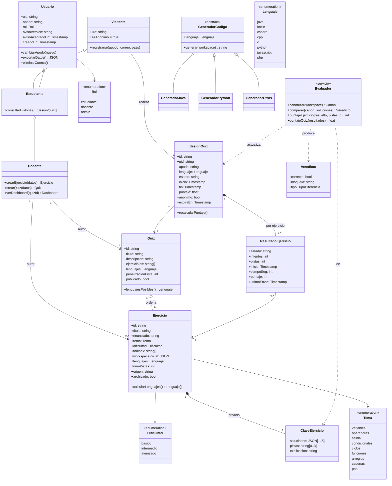

**Notas**
- `GeneradorOtros` resume Kotlin, C#, C++, C, JavaScript y PHP: cada uno es una instancia de `Blockly.CodeGenerator` con una función por tipo de bloque.
- `Evaluador` es un módulo de funciones puras en `api/_lib/`, sin estado. Por eso se prueba con `node:test` sin Firebase.
- `Visitante` y `Estudiante` son el mismo `uid` de Firebase: registrarse no crea otro usuario, solo vincula la credencial.

---

## 2. Modelo de datos (entidad-relación sobre Firestore)

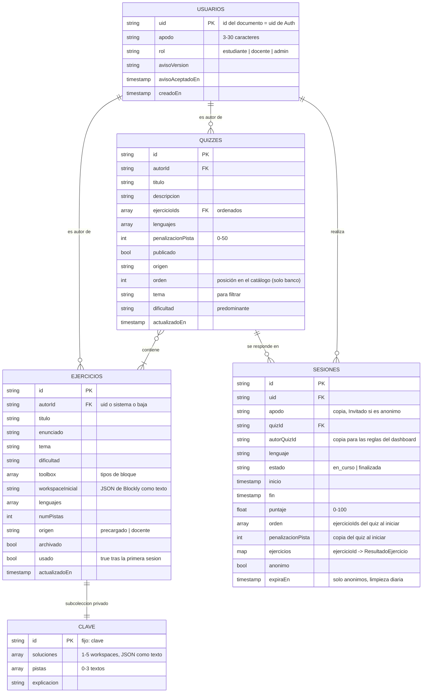

**Decisiones del modelo**

| Decisión | Motivo |
|---|---|
| Soluciones, pistas y explicación en la subcolección `ejercicios/{id}/privado/clave` | Firestore autoriza documentos completos, no campos. Para ocultarlos hay que ponerlos en un documento aparte |
| `ejercicios` (resultados) es un *map* dentro de la sesión, no una subcolección | Un quiz tiene de 5 a 15 ejercicios: cabe de sobra en 1 MiB, se actualiza en una sola escritura y el dashboard lee un documento por sesión |
| `apodo` y `autorQuizId` copiados en la sesión | El dashboard no necesita leer `usuarios` (el docente nunca ve correos) y las reglas validan al lector sin hacer `get()` del quiz |
| No se guardan los workspaces enviados | Minimización (RNF-PRI-02); solo cuentan los intentos |
| Soluciones y workspace inicial como texto JSON | Firestore admite como máximo 20 niveles de anidamiento y cada bloque encadenado de Blockly agrega unos tres; el servidor los interpreta al leerlos |
| `expiraEn` solo en sesiones anónimas + limpieza diaria | Borrado automático a los 30 días (RN-12) |
| Correo y contraseña solo en Firebase Auth | El perfil no duplica el correo; la contraseña nunca llega a la aplicación |

**Índices compuestos:** `sesiones(quizId, inicio desc)`, `sesiones(uid, inicio desc)`, `quizzes(publicado, tema, dificultad)`, `ejercicios(autorId, actualizadoEn desc)`.

---

## 3. Diagramas de secuencia

### SD-01 Registro con vinculación de la sesión anónima (CU-02, FA-1)

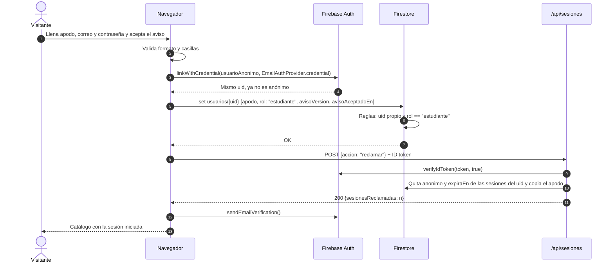

### SD-02 Iniciar quiz (CU-05)

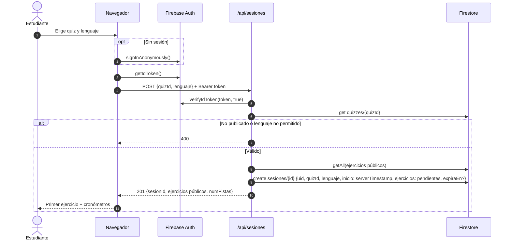

### SD-03 Enviar respuesta (CU-08)

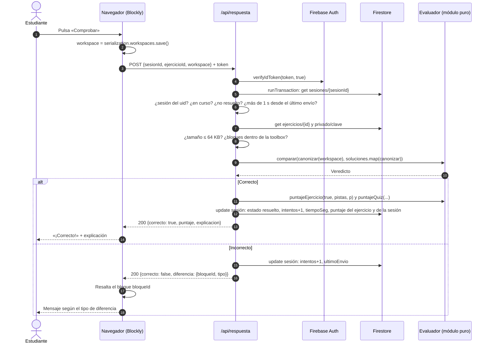

### SD-04 Solicitar pista (CU-07)

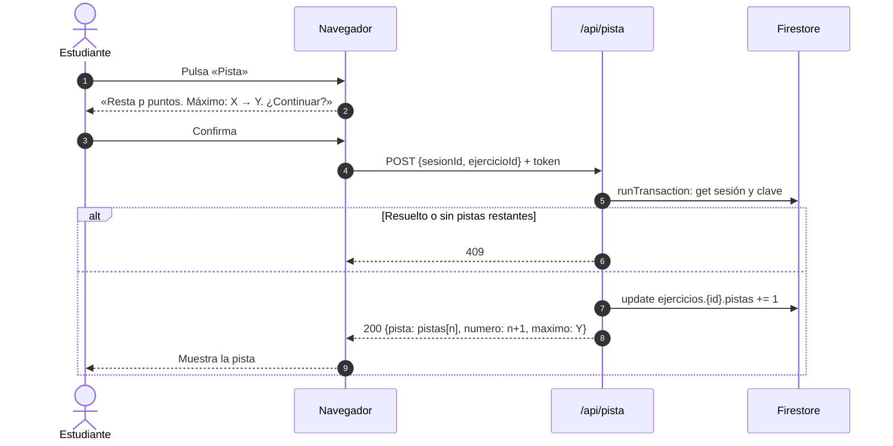

### SD-05 Dashboard y exportación (CU-13)

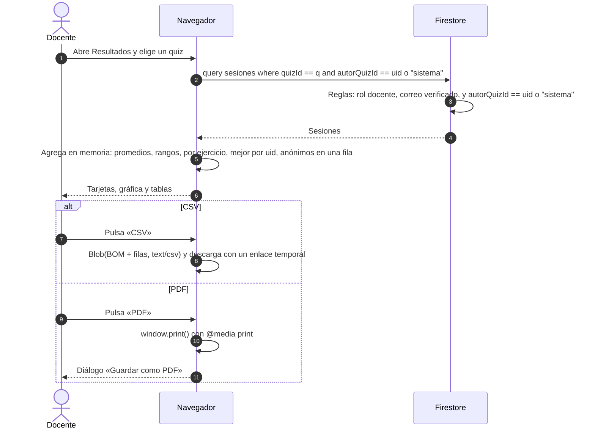

### SD-06 Eliminar cuenta (CU-14)

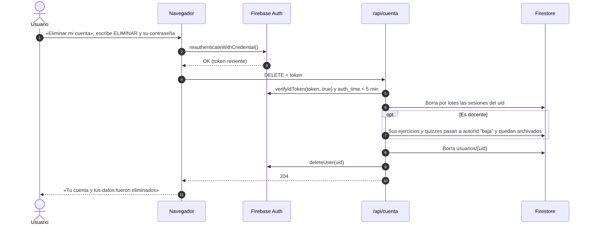

---

## 4. Diagramas de estados

### 4.1 Ejercicio dentro de una sesión

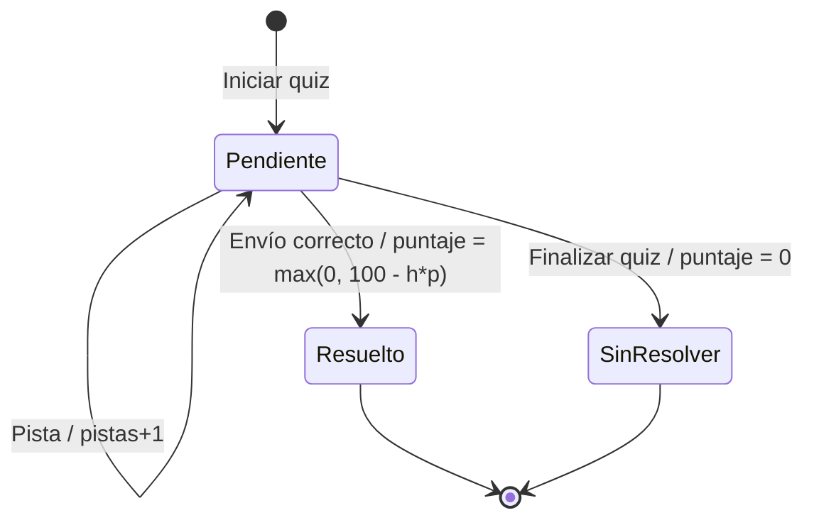

### 4.2 Sesión de quiz

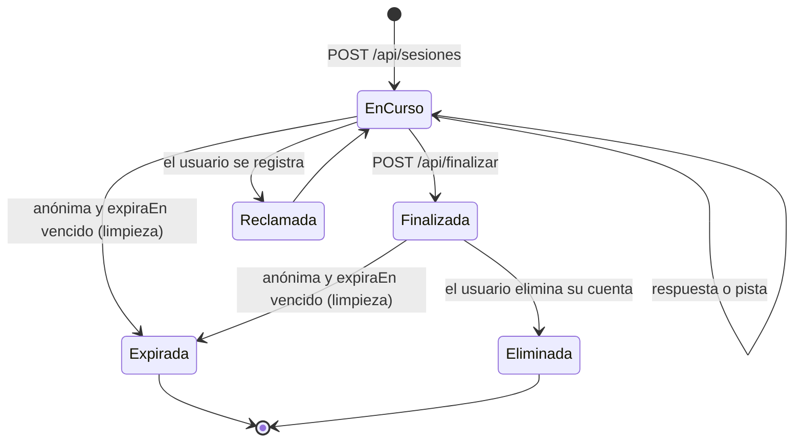

---

## 5. Matriz de permisos (Security Rules)

`C` crear · `L` leer · `A` actualizar · `B` borrar · `—` denegado · **Servidor** = Admin SDK desde Vercel, que salta las reglas.

| Ruta | Visitante / Estudiante | Docente (correo verificado) | Servidor |
|---|---|---|---|
| `usuarios/{uid}` propio | C (solo `rol == "estudiante"`), L, A (solo `apodo`) | igual | CLAB |
| `usuarios/{otro}` | — | — | CLAB |
| `ejercicios/{id}` | — (los recibe de `/api/sesiones`, sin soluciones) | L todos (escribe por `/api/ejercicios`) | CLAB |
| `ejercicios/{id}/privado/clave` | — | L solo si es autor del ejercicio | CLAB |
| `quizzes/{id}` | L si `publicado` | L todos (escribe por `/api/quizzes`) | CLAB |
| `sesiones/{id}` | L si `uid` propio | L si `autorQuizId == uid` o `"sistema"` (la consulta debe filtrar por `autorQuizId`) | CLAB |
| Cualquier otra ruta | — | — | — |

Desde la iteración 5, ejercicios y quizzes los escribe solo el servidor: `/api/ejercicios` y `/api/quizzes` exigen rol docente con correo verificado y validan con las mismas reglas que el banco precargado (`js/bloques/validar.js`): bloques dentro de la paleta, de 1 a 5 soluciones distintas, lenguajes calculados (RN-10), solución fija si el ejercicio ya se respondió (RN-13) y quizzes con resultados que solo cambian sus textos. Las reglas de Firestore quedan en "el cliente lee, el servidor escribe".

Cada regla tiene su prueba de permitir y de denegar en el emulador (RNF-SEG-13): [firestore.rules](../firestore.rules) y [test/reglas.test.js](../test/reglas.test.js).

---

## 6. Despliegue

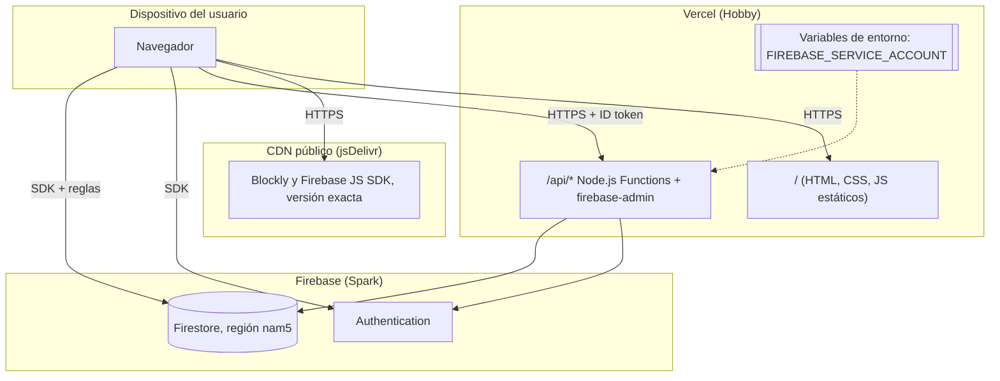

**Estructura de carpetas prevista**

```
index.html  quiz.html  docente.html  cuenta.html  privacidad.html
css/app.css
js/firebase.js  js/bloques.js  js/generadores/{java,kotlin,csharp,cpp,c,python,javascript,php}.js
js/quiz.js  js/docente.js  js/dashboard.js
api/sesiones.js  api/respuesta.js  api/pista.js  api/finalizar.js  api/cuenta.js
api/_lib/{auth.js, evaluador.js}
firestore.rules  firestore.indexes.json  vercel.json
scripts/seed.js  contenido/{ejercicios,quizzes}.json
test/{evaluador,generadores}.test.js  test/reglas.test.js
```
